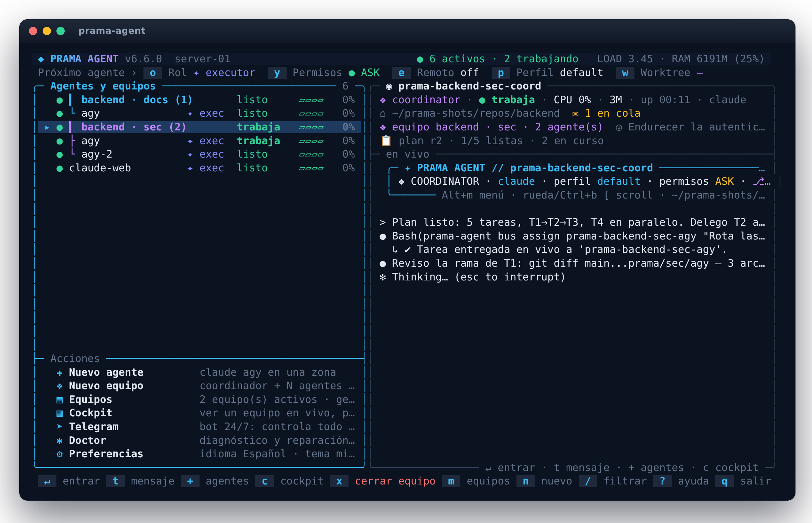
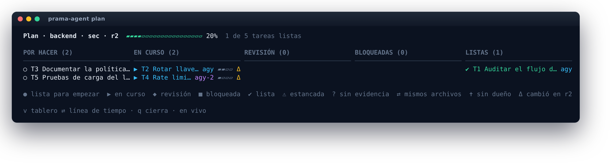
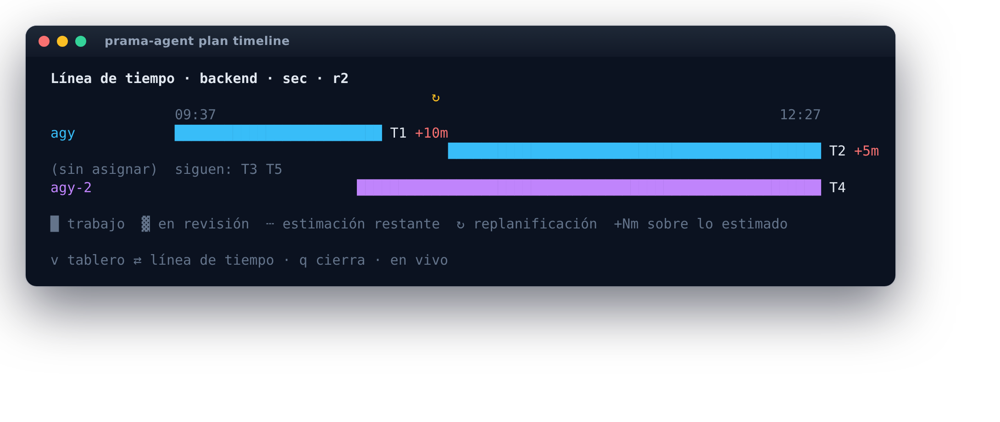
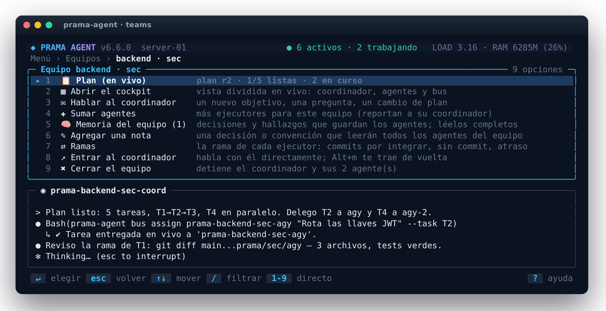
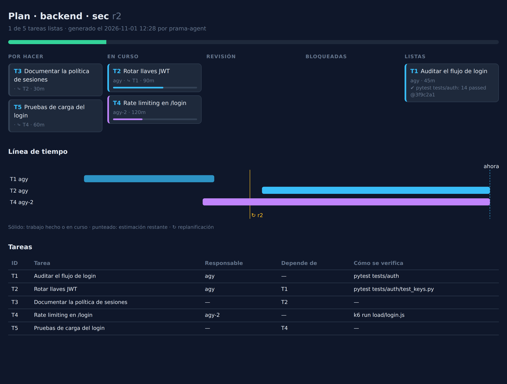
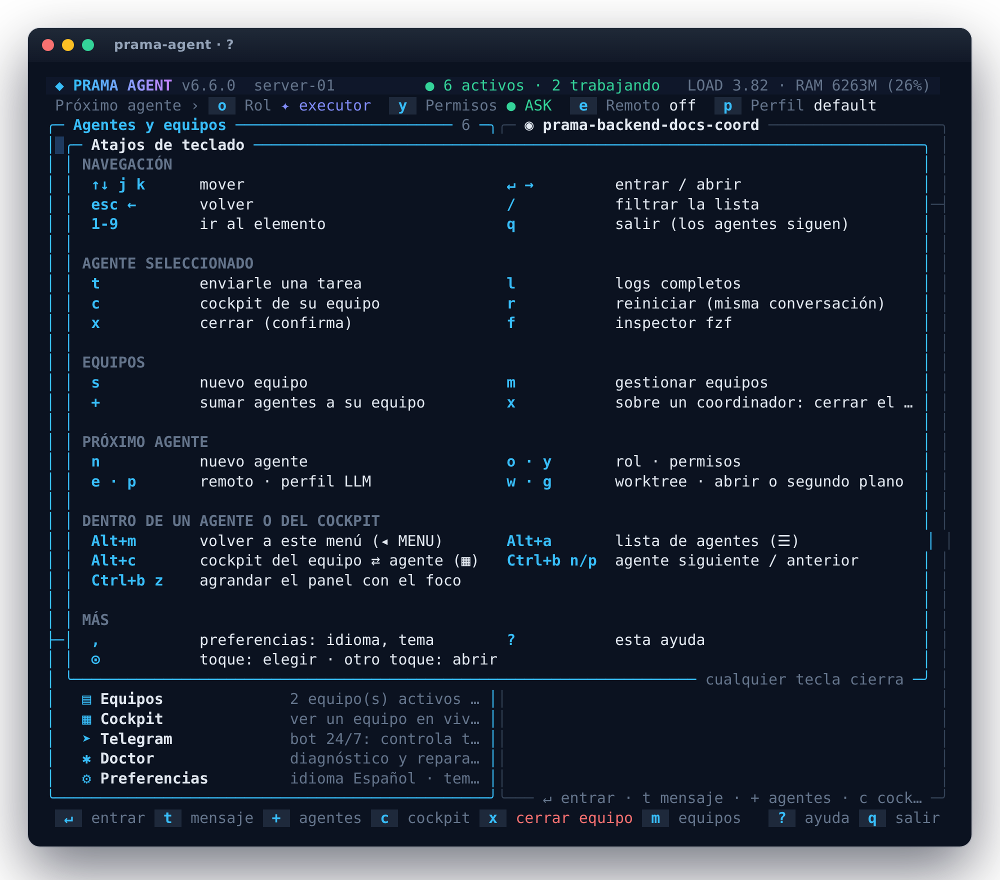
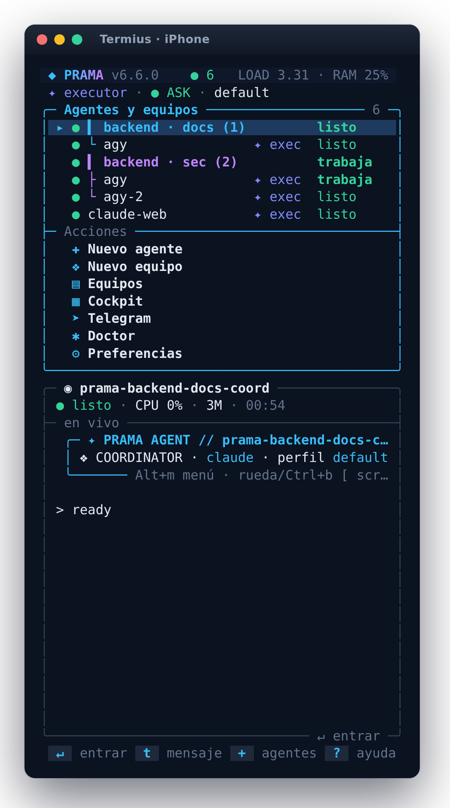
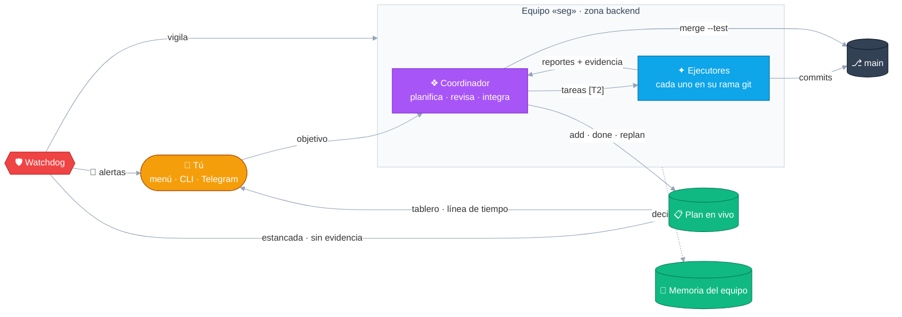
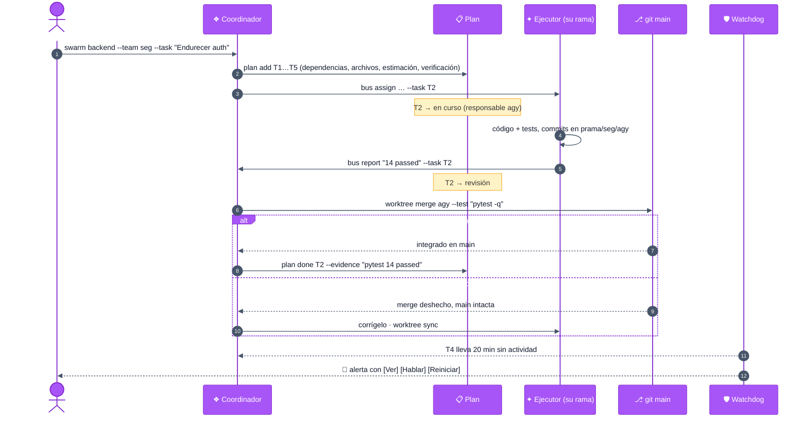
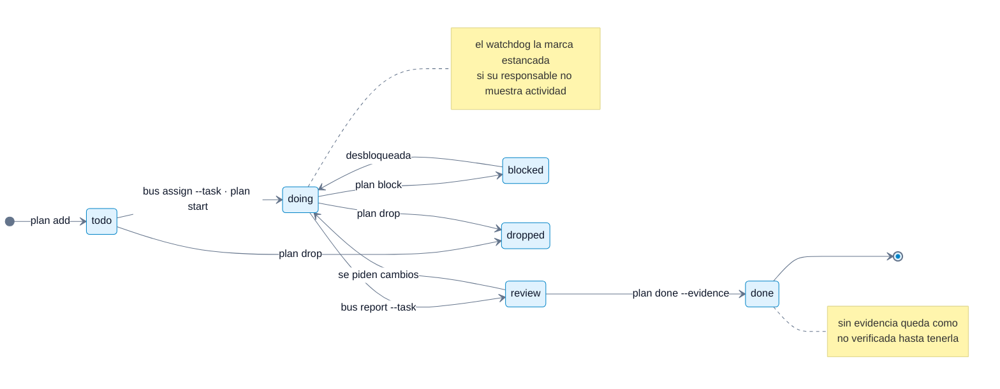

# prama-agent

[English](README.md) · **Español**

[](https://github.com/JSNN15/prama-agent/actions/workflows/ci.yml)
[](LICENSE)


[](https://scorecard.dev/viewer/?uri=github.com/JSNN15/prama-agent)

**Plano de control en la terminal para agentes de código.** prama-agent lanza, supervisa y coordina
[Claude Code](https://docs.anthropic.com/en/docs/claude-code) y Google Antigravity (`agy`) en varios
repositorios, en un servidor remoto o en tu equipo. Las sesiones sobreviven a cortes de SSH, los
agentes se pasan trabajo mediante un bus de mensajes y un agente coordinador puede administrar su
propia flota: lanzar ayudantes, cambiarles el modelo, reiniciarlos y reaccionar cuando uno queda
bloqueado por un login, una cuota o un problema de facturación.

Es bash sobre un servidor tmux dedicado: sin daemon que instalar, sin base de datos, sin Node.js.

<p align="center">
  
</p>

<table>
  <tr>
    <td width="50%"><br><sub><b>Tablero del plan en vivo</b> — lo que planificó el coordinador, quién tiene cada tarea, qué está estancado o sin verificar.</sub></td>
    <td width="50%"><br><sub><b>Línea de tiempo</b> — el trabajo real de cada agente, lo que queda de lo estimado y las replanificaciones marcadas.</sub></td>
  </tr>
  <tr>
    <td><br><sub><b>Equipos</b> — plan, cockpit, mensaje, sumar agentes, memoria, ramas, cerrar.</sub></td>
    <td><br><sub><b>Exportación HTML</b> — <code>prama-agent plan html</code>: tablero, línea de tiempo y tareas en un archivo.</sub></td>
  </tr>
  <tr>
    <td><br><sub><b>Todos los atajos</b>, agrupados por tarea (<code>?</code>).</sub></td>
    <td align="center"><br><sub><b>En el celular</b> — el mismo menú, apilado y con zonas táctiles.</sub></td>
  </tr>
</table>

**Español e inglés, siete temas de color.** Toda la herramienta habla los dos idiomas: el menú, la
CLI, los prompts de rol de los agentes (así reportan en tu idioma) y el bot de Telegram. Sigue tu
locale (`es_*` → español), o elige con `prama-agent lang es|en|auto`. `prama-agent theme` muestra los
temas (midnight, ocean, forest, ember, violet, light para terminales claras, mono de alto contraste);
pintan el menú, la barra de tmux de cada agente y el inspector fzf. Ambos están también en el menú, en
**⚙ Preferencias** (`,`), donde al recorrer los temas se previsualizan en vivo.

## Cómo encaja todo



Una tarea, del plan a `main`:



## Por qué

Usar agentes de código para trabajo real termina en una docena de terminales: una por repositorio,
varias esperando un login, una detenida en silencio por un límite de uso, otra perdida porque se cortó
la conexión SSH. prama-agent las convierte en una flota supervisada:

- **Sesiones persistentes.** Cada agente corre bajo un supervisor en su propia sesión de un servidor
  tmux dedicado (`tmux -L prama`). Cierra el portátil, pierde la conexión y vuelve a entrar desde el
  celular.
- **Salud confiable.** Los agentes informan su estado mediante los hooks del CLI, no solo leyendo la
  pantalla: `READY`, `WORKING`, `BLOCKED` (con motivo: `login`, `auth`, `credit`, `limit`, `trust`,
  `model`), `STANDBY`. Nunca se escribe sobre un agente bloqueado; su trabajo queda en cola.
- **La cuota antes del choque.** El uso de las ventanas de 5 horas y semanal, su hora de reinicio y el
  uso de contexto se recogen de la statusline de cada agente. El coordinador recibe aviso al 90 %.
- **Agentes que administran agentes.** Un coordinador puede lanzar, editar, reiniciar y cerrar
  ayudantes con una API JSON con límites (alcance, máximo, nunca a sí mismo, nunca a otro coordinador).
- **Reinicio en el mismo panel.** Cambiar el modelo o el preset relanza el agente en el mismo panel y
  retoma la misma conversación; el scrollback se conserva.

## Instalación

```bash
curl -fsSL https://raw.githubusercontent.com/JSNN15/prama-agent/main/install.sh | sudo bash
prama-agent setup            # primeros pasos: sesión de los agentes, zonas (carpetas de trabajo), permisos
```

¿Primera vez? **[Primeros pasos](docs/GETTING_STARTED.es.md)** va de un servidor vacío a varios
equipos, incluyendo el inicio de sesión, los modelos y las zonas.

Sin `sudo` se instala para tu usuario (`~/.local/bin`, `~/.config/prama-agent`). Desde un clon:
`sudo make install` o `make install`. Para actualizar: `prama-agent update` (o `update v6.6.0`).
Probado en Ubuntu 22.04 / 24.04 y Debian 12 (tmux 3.2a, 3.3a y 3.4), con cualquier shell de inicio.

Requisitos: bash ≥ 4.4, tmux ≥ 3.2 (3.3+ para los botones táctiles de la barra y el modo celular), git. Recomendados:
`jq` (hooks y telemetría de cuota), `fzf`, `less`. El puente opcional con Telegram necesita `python3`
y `curl`. Al menos un CLI de agente: `claude` (Claude Code) o `agy` (Antigravity CLI), con sesión iniciada: las
credenciales las guarda cada CLI (`prama-agent login` muestra y abre su inicio de sesión; prama nunca
las almacena).

## Uso rápido

```bash
prama-agent                                   # interfaz interactiva
prama-agent swarm backend --team api --workers agy:3 --task "Agrega rate limiting a la API pública"
                                              # coordinador + 3 agy, abre el cockpit del equipo
prama-agent claude backend                    # lanza Claude Code en la zona "backend" y entra
prama-agent agy web --bg -w feat/login        # en segundo plano, aislado en un git worktree
prama-agent claude backend --role reader      # auditor de solo lectura (plan mode)
prama-agent status                            # resumen de la flota
prama-agent attach prama-claude-backend       # volver a entrar (Alt+m regresa al menú)
```

Una **zona** es una carpeta de trabajo con nombre, normalmente un repositorio:
`prama-agent zones add backend /srv/api` (o `setup`); `zones scan` lista los repositorios aún sin
registrar. Mientras no registres ninguna, cada repositorio git bajo `PRAMA_DISCOVER_ROOTS` (`/opt`,
`$HOME`) es una zona.

### Interfaz interactiva

| Tecla | Acción | Tecla | Acción |
| --- | --- | --- | --- |
La barra inferior muestra siempre las teclas de lo seleccionado (las destructivas en rojo) y `?` abre
todos los atajos agrupados por tarea:

| Tecla | Acción | Tecla | Acción |
| --- | --- | --- | --- |
| `↑↓` `jk` `1-9` | moverse | `↵` | entrar a la sesión / elegir |
| `n` | nuevo agente (asistente) | `s` | nuevo equipo (coordinador + N agentes) |
| `m` | **equipos**: cockpit, mensaje, sumar agentes, memoria, cerrar | `+` | sumar agentes al equipo seleccionado |
| `t` | enviar una tarea (a un coordinador: un mensaje) | `c` | cockpit del equipo |
| `l` | historial (`less`) | `r` / `x` | reiniciar / cerrar (con confirmación) |
| `/` | filtrar | `f` | inspector `fzf` con vista previa |
| `,` | preferencias: idioma, tema, mouse | `?` | ayuda |
| `o` `y` `e` `p` `w` `g` | rol · permisos · remoto · perfil LLM · worktree · segundo plano | `q` | salir |

Las sesiones se agrupan por equipo: la fila del coordinador es el equipo (`▍ backend · seg (2)`, un
color por equipo) y sus agentes cuelgan debajo (`├ agy`, `└ agy-2`); `x` sobre un coordinador cierra
ese equipo y nada más. La interfaz se adapta al ancho (lado a lado desde 100 columnas, apilada en el
celular), se refresca cada 2 s y admite toques y rueda del ratón.

## Equipos y cockpit

```bash
prama-agent swarm backend --team arquitectura --workers agy:2 --task "Separar el módulo de facturación"
prama-agent swarm backend --team seguridad --workers agy:1,claude:1 --worker-model gemini-3.8-flash-high
prama-agent swarm backend --team docs --workers agy:1 --task "Documentar la API pública"
prama-agent teams                                 # todos los equipos: zona, nombre, coordinador, agentes, objetivo
prama-agent cockpit backend --team seguridad      # vista dividida en vivo de un equipo
prama-agent swarm stop backend --team docs        # cierra un equipo (coordinador y sus agentes)
```

**Varios equipos por zona.** Cada equipo tiene un nombre único en su zona, su propio coordinador,
objetivo y cockpit, y no se mezclan: los reportes y alertas de un agente van a su coordinador,
`bus assign executor` desde un coordinador elige a uno de sus agentes, y un coordinador no puede
gestionar, ampliar ni cerrar otro equipo. `swarm` con el nombre de un equipo existente le suma
agentes; sin `--team` crea el equipo `principal` de la zona, o pide un nombre si la zona ya tiene
equipos.

El coordinador recibe la lista de su equipo y el objetivo apenas está listo, delega por el bus y puede
hacer crecer su equipo (`swarm <su zona> --workers agy:2`), cambiar modelos o cerrar agentes.

El **cockpit** muestra al coordinador a la izquierda, sus agentes apilados a la derecha y el bus en vivo
abajo; se reconstruye solo cuando entran o salen agentes. Dentro del tmux de prama, desde cualquier
agente o desde el cockpit:

| Tecla | Botón de la barra | Acción |
| --- | --- | --- |
| `Alt+m` | `◂ MENU` | volver al menú (los agentes siguen trabajando) |
| `Alt+a` | `☰ AGENTES` | lista de agentes (equipos, estado, modelo, cuota): ir a cualquiera o a un cockpit |
| `Alt+c` | `▦ COCKPIT` | cockpit del equipo ⇄ el agente con el foco |
| `Ctrl+b n` / `Ctrl+b p` | `▶` / `◀` (celular) | agente siguiente / anterior; dentro del cockpit, el panel siguiente / anterior |
| `Ctrl+b z` | | agrandar el panel con el foco en el cockpit |

Las teclas se configuran con `PRAMA_MENU_KEY`, `PRAMA_NAV_KEY` y `PRAMA_COCKPIT_KEY`; los botones
funcionan con toques en Termius, Blink o cualquier terminal con soporte de mouse.

### Equipos aislados: una rama por agente

Varios agentes editando la misma carpeta se pisan. Por eso un equipo nuevo en una zona git queda
**aislado**: cada ejecutor trabaja en su propio git worktree (fuera del repositorio) en la rama
`prama/<equipo>/<nombre>`, creada desde la rama en que está la zona; el coordinador se queda en esa rama
e integra.

```bash
prama-agent swarm backend --team seg --workers agy:2        # aislado (por defecto; --shared para no)
prama-agent worktree status backend --team seg              # cada rama: por integrar, sin commit, atraso
prama-agent worktree merge prama-backend-seg-agy --test "pytest -q"   # integra; se deshace si fallan los tests
prama-agent worktree sync prama-backend-seg-agy-2           # pone una rama al día con la base
```

- `merge` rechaza un checkout base con cambios y **aborta si hay conflicto**: la base nunca queda rota;
  el ejecutor hace `worktree sync`, resuelve en su worktree, hace commit y el coordinador vuelve a
  integrar. Con `--test` (o `PRAMA_MERGE_TEST`) un merge que rompe los tests se deshace.
- Solo el coordinador (o tú) integra; un ejecutor solo hace commit en su rama y se pone al día.
- Los prompts de rol llevan el protocolo: los ejecutores hacen commit con evidencia y el coordinador
  reparte por archivos, integra una rama a la vez y pide a los demás ponerse al día.
- `swarm stop` borra los worktrees limpios e integrados y **conserva** los que tienen trabajo sin
  integrar o sin commit (`worktree clean` hace lo mismo después).
- Dependencias: cada worktree es un checkout nuevo. Los `.env` se copian (`PRAMA_WORKTREE_COPY_FILES`);
  `PRAMA_WORKTREE_LINK="node_modules .venv"` comparte directorios pesados con el checkout principal en
  vez de reinstalarlos; si no, los ejecutores instalan lo que necesiten.
- En el menú, el asistente de nuevo equipo pregunta *una rama por agente* o *carpeta compartida*, y
  **Equipos → Ramas** muestra el estado de cada rama; en Telegram, equipo → **⎇ Ramas**.

### Memoria del equipo

Una conversación muere con su agente (un reinicio, un cambio de modelo, una cuota); las decisiones del
equipo no deberían. Cada equipo tiene una memoria compartida de notas breves y fechadas, y cada zona una
común a todos sus equipos:

```bash
prama-agent memory show backend --team seg        # las notas de la zona y luego las del equipo
prama-agent memory add backend --team seg "Las llaves JWT rotan a diario; nunca loguearlas"
prama-agent memory add backend --zone-wide "Python 3.12, FastAPI, tests con pytest -q"
prama-agent memory                                # todas: zona, equipo, notas, último cambio
```

Los agentes la usan solos: su prompt de rol les pide leerla al empezar y registrar decisiones,
convenciones y en qué va el trabajo con `prama-agent memory add` (un agente escribe en su propio
equipo). El brief del coordinador dice cuántas notas hay, así un coordinador reiniciado o un ejecutor
nuevo retoma donde iba. Las notas quedan en el servidor (`~/.local/state/prama-agent/memory`, modo
`0700`), redactadas como los reportes de fallos, con las `PRAMA_MEMORY_MAX_LINES` (200) más recientes;
solo el operador puede borrar una. El menú (**Equipos → Memoria del equipo**) y Telegram
(**🧠 Memoria**) también las muestran y agregan.

## El plan en vivo

No deberías tener que preguntarle al coordinador qué está haciendo. Él mantiene el plan del equipo con
comandos de una línea, prama lo muestra en vivo y el watchdog lo contrasta con lo que los agentes
hacen de verdad.

```bash
prama-agent plan add "Rotar las llaves JWT" --deps T1 --est 90m --scope "src/auth/keys.py" --accept "pytest tests/auth"
prama-agent bus assign prama-backend-seg-agy "Rota las llaves sin downtime" --task T2   # T2 → en curso
prama-agent bus report "14 passed @3f9c2a1" --task T2                                    # (ejecutor) T2 → revisión
prama-agent plan done T2 --evidence "pytest tests/auth: 14 passed"
prama-agent plan replan "La auditoría pide rate limiting primero"                        # r2, queda en el historial
prama-agent plan backend --team seg            # tablero  ·  plan timeline  ·  plan log  ·  plan html
```

- **Tablero y línea de tiempo en vivo**: en el cockpit del equipo (un panel propio), en el menú
  (**Equipos → 📋 Plan**, `v` cambia de vista), en Telegram (equipo → **📋 Plan**) y como archivo HTML
  autocontenido.
- **Hecho para planes que cambian**: cada replanificación es una revisión numerada con su motivo,
  marcada en la línea de tiempo (↻) y en las tareas que tocó (Δ); el historial nunca se reescribe.
- **Honesto por diseño** (lo que según los estudios importa): una tarea *en curso* cuyo responsable no
  muestra actividad queda **estancada**, *lista* sin evidencia queda **sin verificar**, dos tareas en
  curso sobre los mismos archivos quedan **solapadas**, y una cuyas dependencias terminaron y nadie tomó
  queda **lista para empezar**. El watchdog avisa al coordinador, una vez por hora y tarea.
- Solo el coordinador (o tú) cambia el plan; un ejecutor mueve su propia tarea (avance, reporte).

Cómo avanza una tarea:



## Desde el celular

El cockpit rinde mejor en tablet o computador, y está pensado para funcionar también en el celular:

- **Modo compacto, automático.** En una pantalla de menos de `PRAMA_COMPACT_COLS` (100 columnas) el
  cockpit muestra un agente a la vez, a pantalla completa, y la barra inferior pasa a botones grandes
  para tocar: `◂` menú · `◀` anterior · `☰` agentes · `▶` siguiente · `▦` cockpit. Gira a horizontal o
  abre la misma sesión en un computador y vuelve la vista dividida. Si agrandaste un panel tú mismo
  con `Ctrl+b z`, se respeta. (tmux ≥ 3.3; con 3.2, agranda a mano con `Ctrl+b z`.)
- **El menú se adapta** al ancho: una columna, etiquetas cortas y la vista en vivo del agente
  seleccionado debajo de la lista.
- **Usa mosh.** Mantiene la conexión al pasar de wifi a datos, en túneles y con la pantalla bloqueada,
  donde SSH se corta. En el servidor: `sudo apt install mosh` y abre UDP 60000-61000; en el celular,
  Termius o Blink: `mosh usuario@servidor -- prama-agent`. `prama-agent doctor` te dice si mosh está
  disponible.
- **Telegram para una mirada rápida.** Estado del equipo, cuota, hablarle al coordinador o cerrar un
  equipo, en dos toques desde el bot (ver abajo), sin terminal.

## Administración de la flota

La API detallada que usan los equipos, disponible para ti y para el coordinador; `--json` da salida
para máquinas.

```bash
prama-agent fleet status --json              # estado, motivo de bloqueo, modelo, preset, cola, cuota
prama-agent fleet spawn agy backend --preset cheap --task "Agrega tests a utils/date.ts"
prama-agent fleet model prama-claude-backend-2 sonnet      # mismo panel, misma conversación
prama-agent fleet edit  prama-claude-backend-2 --effort high --preset reviewer
prama-agent fleet restart <sesión> · fleet kill <sesión> · fleet presets · fleet models agy
prama-agent fleet hooks status               # hooks de salud de cada CLI
```

- **Watchdog.** Una sesión interna arranca con el primer agente. Avisa al coordinador de la zona (y a
  Telegram, si está configurado) cuando un agente se bloquea, se detiene, se recupera o cruza el umbral
  de cuota, y entrega las tareas en cola cuando el agente vuelve a estar listo.
- **Límites para los agentes.** Un agente no puede actuar sobre sí mismo ni sobre un coordinador, solo
  dentro de su alcance (`PRAMA_FLEET_SCOPE=zone|children|all`), y `spawn` respeta `PRAMA_FLEET_MAX`.
  Cada acción queda registrada en el bus.
- **Cambiar de modelo nunca altera tus valores por defecto.** prama reinicia el agente con `--model` en
  vez de escribir `/model`, que en Claude Code también reescribe tu modelo global. Los ids de modelo de
  agy se validan contra `agy models`, porque agy usa en silencio su modelo por defecto si el id no
  existe.

### Cómo se obtienen la salud y la cuota

| | Claude Code | Antigravity (`agy`) |
| --- | --- | --- |
| Hooks | `SessionStart`, `UserPromptSubmit`, `Stop`, `StopFailure`, `Notification`, … inyectados por sesión con `--settings` | `SessionStart`, `PreInvocation`, `Stop` (el texto del error se clasifica) |
| Dónde | solo en la sesión; `~/.claude` no se modifica | una entrada con nombre, `prama-agent`, en `~/.gemini/config/hooks.json` (agy no admite hooks por sesión); no hace nada fuera de los paneles de prama; `fleet hooks uninstall` la elimina |
| Cuota | `rate_limits` de la statusline (5 h / 7 d) | buckets de `quota` de la statusline para la familia del modelo activo |
| Reanudar | `--session-id` / `--resume <id>` | `--conversation <id>` (id que informan los hooks) |

La lectura de pantalla queda como respaldo para los diálogos que aparecen antes de los hooks (login,
confianza en la carpeta, selector de modelo). Si ya usas una statusline propia en Claude Code, prama la
encadena.

## Roles y enjambres

| Rol | Uso |
| --- | --- |
| `✦ executor` | implementa y prueba; informa con `prama-agent bus report` |
| `❖ coordinator` | planifica, delega con `bus assign` y administra la flota |
| `◉ reader` | revisor de solo lectura (plan mode) |
| `♺ daemon` | procesa una cola de tareas en bucle (`--loop 60 --task "…"`) |

```bash
prama-agent bus assign prama-agy-backend-2 "Implementa /health y corre pytest"
prama-agent bus assign executor "…"              # por rol: el ejecutor más reciente
prama-agent bus report "Endpoint listo; 18/18 tests ok"
prama-agent bus watch                            # eventos en vivo
```

`assign` acepta un nombre exacto de sesión o un rol y nunca hace coincidencias parciales. Solo se
escribe en agentes listos o trabajando; lo demás queda en cola (colas Maildir, seguras con varios
consumidores).

## Presets

`--preset <nombre>` aplica de una vez agente, modelo, esfuerzo, rol, prompt adicional y una carpeta de
skills. Incluidos: `reviewer` (Claude, solo lectura), `architect` (Claude, esfuerzo muy alto) y `cheap`
(agy Flash para trabajo mecánico). Los tuyos van en `~/.config/prama-agent/presets/<nombre>.env`; un
`SKILLS_DIR` con carpetas `<skill>/SKILL.md` se monta como plugin solo para ese agente. Ver
[presets/README.md](presets/README.md).

## Permisos y seguridad

| Modo | Flag | Comportamiento |
| --- | --- | --- |
| **ASK** (por defecto) | `--ask` | el agente pregunta antes de cada acción |
| **PLAN** | `--plan`, `--role reader` | modo de solo lectura nativo del CLI |
| **YOLO** | `--yolo`, `PRAMA_SKIP_PERMISSIONS=1` | sin confirmaciones; para servidores aislados que controlas |

Garantías de diseño (detalle en [docs/ARCHITECTURE.md](docs/ARCHITECTURE.md)):

- **Servidor tmux dedicado**: tus sesiones tmux y tu `~/.tmux.conf` nunca se tocan.
- Todo el estado vive en `~/.local/state/prama-agent` (modo `0700`); nada en `/tmp`.
- Estado, colas y eventos son datos: nunca se ejecutan con `source` ni `eval`.
- Las claves de API nunca aparecen en la línea de comandos (`ps`); se aplican dentro del panel.
- Objetivos tmux exactos: cerrar `prama-claude` nunca cierra `prama-claude-backend`.
- Cerrar una sesión termina todo su grupo de procesos: no quedan agentes huérfanos corriendo.

Para reportar vulnerabilidades, ver [SECURITY.md](SECURITY.md).

## Telegram (control desde el celular)

```bash
prama-agent telegram setup     # pega el token de @BotFather y envía al bot el código de un solo uso
prama-agent telegram start     # bot 24/7 en una sesión persistente (status | logs | restart | stop)
```

Emparejamiento con código de un solo uso (solo tu chat y tu usuario quedan autorizados), menús con
botones y argumentos validados contra listas blancas. Desde el bot puedes:

- **Equipos** (`/equipos`): todos los equipos, varios por zona, con sus agentes, estado, modelo y
  cuota; *hablar al coordinador* (lo que escribas después le llega a él), ver su pantalla, sumar un
  agente o cerrar ese equipo (con confirmación). *Nuevo equipo* pide la zona, el equipo (uno existente,
  un nombre sugerido o el tuyo) y los ejecutores (`agy × 1-3`, …), y toma tu siguiente mensaje como
  objetivo.
- **Alertas** (`/alertas`): los agentes que te necesitan (bloqueados por login, crédito o cuota,
  detenidos, o sobre el 90 % de una ventana de cuota), cada uno con *ver pantalla*, *reiniciar* y
  *cerrar*. Las alertas del watchdog también llegan como mensajes con esos botones: actúas con un toque.
- **Daemons** (`/daemons`): los agentes daemon con su estado y su cola; *encolar tarea* toma tu
  siguiente mensaje.
- **Memoria del equipo** (equipo → 🧠 Memoria): las últimas notas del equipo; *agregar nota* toma tu
  siguiente mensaje.
- **Avisos** (`/avisos`): elige qué te manda el bot — todo, lo importante (sin tráfico del bus), solo
  alertas o nada — y `/silencio 1h` (30m, 8h, 24h, off) para recibirlos sin sonido. También desde el
  servidor: `prama-agent telegram alerts important`, `prama-agent telegram mute 8h`.
- **Cuota** (`/cuota`): 5 h / 7 d / contexto por agente, marcada al 90 %.
- **Agentes**: ver pantalla, hablar, lanzar, reiniciar o cerrar; **reportes de fallos** de los
  agentes (`/reportes`).

Los comandos funcionan en ambos idiomas (`/equipos` = `/teams`, `/alertas` = `/alerts`,
`/silencio` = `/mute`…); el menú y los textos del bot siguen el idioma de la interfaz.

El bot equivale a una terminal remota: protege tu cuenta de Telegram con verificación en dos pasos.

## Reportar fallos de prama-agent (también los agentes)

Los agentes usan prama todo el día, así que son los primeros en notar cuando algo falla. Todos los
roles traen un canal interno para eso:

```bash
prama-agent feedback "fleet model agy-backend-2 gemini-4-argon-medium: reinició con el modelo anterior"   # agente o tú
prama-agent feedback list                  # reportes abiertos (también en doctor, el menú y Telegram /reportes)
prama-agent feedback show <id>             # reporte y contexto: versión, agente, modelo, estado, últimos eventos
prama-agent feedback export <id> | gh issue create -R JSNN15/prama-agent -t "…" -F -
prama-agent feedback close <id>
```

Los reportes quedan en el servidor (`~/.local/state/prama-agent/feedback`, modo `0700`), con las claves
de proveedores y todo lo que parezca un token reemplazado por `***`. Un reporte repetido se cuenta en
vez de duplicarse, el operador recibe aviso (bus y Telegram) y **nada se publica sin ti**: `export`
genera el Markdown para la [plantilla de reporte](.github/ISSUE_TEMPLATE/bug_report.yml), tú lo revisas
y lo publicas.

## Perfiles LLM

`--profile` dirige Claude Code a otro endpoint compatible con Anthropic: `openrouter`, `deepseek`,
`glm` o `local` (un router como claude-code-router). Las claves van en `providers.env` (`chmod 600`).

```bash
prama-agent profiles
prama-agent claude backend --profile deepseek
```

## Configuración

`/etc/prama-agent/config.env` y luego `~/.config/prama-agent/config.env` (sintaxis bash, ver
[config/config.env.example](config/config.env.example)).

| Variable | Por defecto | |
| --- | --- | --- |
| `ZONES` / `ZONE_DIRS` | descubiertas | directorios de trabajo con nombre |
| `PRAMA_SKIP_PERMISSIONS` | `0` | `1` = YOLO por defecto |
| `PRAMA_DEFAULT_REMOTE` | `0` | control remoto de los CLIs activado por defecto |
| `PRAMA_FLEET_MAX` / `PRAMA_FLEET_SCOPE` | `8` / `zone` | límites de la flota para los agentes |
| `PRAMA_HOOKS` / `PRAMA_STATUSLINE` | `1` / `1` | hooks de salud / telemetría de cuota |
| `PRAMA_QUOTA_WARN` | `90` | umbral de alerta de cuota (%) |
| `PRAMA_WATCHDOG` | `1` | watchdog de la flota |
| `PRAMA_SWARM_WORKERS` | `agy:2` | ejecutores por defecto de `swarm` |
| `PRAMA_MENU_KEY` / `PRAMA_NAV_KEY` / `PRAMA_COCKPIT_KEY` | `M-m` / `M-a` / `M-c` | teclas de navegación en tmux |
| `PRAMA_COMPACT_COLS` | `100` | clientes más angostos reciben el modo celular |
| `PRAMA_FEEDBACK_MAX_OPEN` | `50` | reportes abiertos antes de pedir a los agentes que esperen |
| `PRAMA_SWARM_ISOLATE` | `1` | equipos nuevos en una zona git: un worktree y una rama por ejecutor |
| `PRAMA_WORKTREE_LINK` | — | directorios enlazados desde el checkout principal en cada worktree (`node_modules .venv`) |
| `PRAMA_MERGE_TEST` | — | comando de tests tras cada `worktree merge` (si falla, se deshace el merge) |
| `PRAMA_LANG` | `auto` | idioma: `es`, `en`, `auto` (según el locale); `prama-agent lang` |
| `PRAMA_THEME` | `midnight` | tema de color; `prama-agent theme` los lista |
| `PRAMA_TUI_MOUSE` | `1` | mouse y toques en el menú |
| `PRAMA_TG_NOTIFY` | `all` | avisos de Telegram: `all`, `important`, `alerts`, `off` (`/avisos` del bot lo reemplaza) |
| `PRAMA_MEMORY_MAX_LINES` | `200` | notas que guarda cada memoria de equipo / zona |
| `PRAMA_EXPERIMENTAL` | `0` | habilita agentes experimentales (OpenCode) |

Los **worktrees** (`-w <rama>`) se crean fuera del repositorio
(`<padre>/.prama-worktrees/<repo>/<rama>`), reutilizan la rama si ya existe sin reiniciarla y copian
`.env`, `.env.local` y `.mcp.json`.

## Estado y hoja de ruta

| Agente | Estado |
| --- | --- |
| Claude Code | soportado: hooks, cuota, reanudación, presets, control remoto |
| Antigravity (`agy`) | soportado: hooks, cuota, reanudación, validación de modelos, control remoto |
| OpenCode | **experimental**: integrado y probado, desactivado por defecto (`PRAMA_EXPERIMENTAL=1`) |
| Hermes Agent | **en evaluación**, no integrado |

Lanzar agentes en otros servidores por SSH desde el mismo prama-agent está planificado.

OpenCode y Hermes son los dos candidatos serios para usar modelos abiertos (Qwen, Kimi, GLM,
DeepSeek) vía OpenRouter como agentes de bajo costo. La evaluación y los criterios para habilitarlos
están en [docs/ROADMAP.md](docs/ROADMAP.md).

## Migrar desde v5

`prama-agent doctor` detecta y limpia lo que dejó v5: borra el bus inseguro `/tmp/prama-bus`,
`doctor --restore-tmux-conf` restaura tu `~/.tmux.conf` original y avisa de agentes que corren fuera de
prama (no sobreviven a un corte de SSH). Las sesiones de v5 vivían en tu tmux personal; v6 usa su
propio servidor.

## Desarrollo

```bash
make lint          # bash -n, shellcheck, py_compile
make test          # tests del bot de Telegram + suite de extremo a extremo en tmux, HOME y estado aislados
make test-matrix   # la matriz del CI en contenedores locales: Ubuntu 22.04, Debian 12, Ubuntu 24.04
```

El CI corre la suite en contenedores limpios (tmux 3.2a, 3.3a y 3.4; un usuario sin privilegios con
`/bin/sh` como shell), más shellcheck, actionlint, CodeQL y OpenSSF Scorecard. Las Actions están
fijadas por SHA de commit y Dependabot las mantiene al día; los releases se publican desde el tag y
`CHANGELOG.md`.

Arquitectura, invariantes de seguridad y API interna: [docs/ARCHITECTURE.md](docs/ARCHITECTURE.md)
(en inglés). Contribuir: [CONTRIBUTING.md](CONTRIBUTING.md). Cambios: [CHANGELOG.md](CHANGELOG.md).

## Autor

Creado y mantenido por **Julian Neira Nova** (Santiago de Chile) · [@JSNN15](https://github.com/JSNN15).
Si usas prama-agent en tu trabajo, [CITATION.cff](CITATION.cff) tiene la cita.

## Licencia

[Apache License 2.0](LICENSE) · ver [NOTICE](NOTICE). Claude Code y Antigravity son marcas de sus
respectivos dueños; este es un proyecto independiente.
